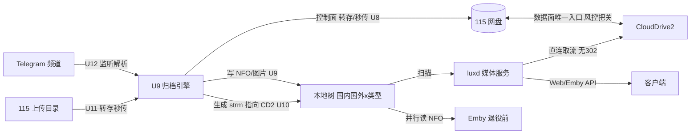
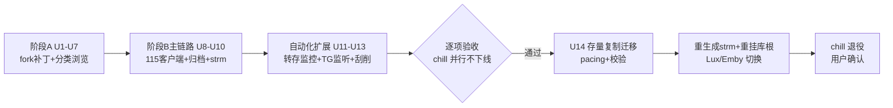

# Lux Fork 稳定性修复 + chill 能力重实现 - Plan

**Target repo:** Lux（fork 自 github.com/Qoo-330ml/Lux `test` 分支 0.6.9），仓库位于 NAS `qiangli@192.168.8.8:/vol5/1000/build/lux`（ssh -p 4888，密钥 `id_ed25519_feiniu`）。本文所有文件路径均为该仓库的相对路径。

## Goal Capsule

- **Objective:** 用户拥有一个完全自己掌控的媒体系统：Lux 底座在 18 万条目规模下浏览、搜索、播放全部稳定快速且按类别清晰分开；同一个项目逐步具备 chill 的归档能力（115 转存/秒传、Telegram 监听、整理、strm 生成、通知、TMDB 元数据），最终 chill 退役，体系中不再有不可控的闭源组件。
- **Means:** fork Lux 0.6.9 打补丁（阶段 A），再以行为级重实现把 chill 能力做成 luxd 内的 Rust 模块（阶段 B）（KTD1、KTD8）。
- **Authority:** 用户约束优先于一切技术偏好：chill/Emby/CloudDrive2 在退役前零改动；媒体挂载 `:ro`；不开 STRM 远程探测（115 风控）；SQLite；端口 8098；所有修改经公开 GitHub fork 承载（LUX-NCSAL 第 3 条）。
- **Stop conditions:** 每个 U 的 Verification 达成即止；阶段 B 各单元开工前需先产出各自的细化子规划（本计划只锁定到工作包粒度）；任何 115 风控异常立即停止相关单元。
- **Execution profile:** 每个 U 由独立子对话执行（总规划 + 子对话模式）；代码修改、构建、部署全部经 NAS ssh；构建管线已验证可用（`docker build -f Dockerfile.custom`）。
- **完成与交付:** 用户验收每个阶段的实机效果；chill 退役由用户最终确认。

---

## Product Contract

### Summary

分两阶段：阶段 A 在 fork 上修复 Lux 在用户真实库（18.2 万 strm / 16.1 万分集 / 54 万文件系统条目）上暴露的三个缺陷——首页挂死、挂载中断后剧集可用性不恢复导致搜索挂死、毒批次无限重试——并调优连接池/WAL，同时新增"按一级目录分类浏览"。阶段 B 在同一 Rust 项目内行为重实现 chill 的归档链路（115 转存/秒传、Telegram 监听、按"国内/国外×类型"归档整理、strm 生成指向 CloudDrive2、通知、TMDB 元数据复用 Lux 刮削器），播放走 Lux 直连、不做 302 代理；功能完善后把存量资源以服务端**复制**方式迁入 115 新根目录，批量重生成 strm，切换 Lux/Emby，chill 退役。

### Problem Frame

现有体系依赖闭源的 CineChill（Python，核心模块编译为 .so，GitHub 仓库 404）做 115 归档与 302 播放中转，不可控、不可审计、随时可能停更。Lux 0.6.7 在用户规模上实测暴露：首页/轮播/最新接口 30-40s 超时（根因：元数据回填每批完成即使首页缓存代际失效，快照构建被无限重启）；挂载中断恢复后 SERIES/SEASON 的 `has_available_source` 永久为 0，全量 reconcile 不修复，剧集/季搜索从 1.2s 恶化为 30s 挂死（手工 SQL 恢复后验证了因果）；本地 NFO 回填对确定性校验失败（路径含 `*`/`[` 的条目触发 image-roots 检查失败）无熔断，单批重试 423 次饿死 worker。三个缺陷均有实测证据并已整理成上游 issue 材料。

### Requirements

**稳定性（阶段 A）**

- R1. 首页及其全部 section（carousel、latest、继续观看、收藏）在 18 万条目库上 3 秒内返回，且不被后台元数据回填的写风暴饿死。
- R2. 剧集/季/混合搜索 2 秒内返回；挂载中断恢复后，SERIES/SEASON 可用性由系统自动重算恢复，无需人工修数据库。
- R3. 本地元数据回填遇到确定性失败的条目时自动跳过并记录不可重试，批次继续推进；不存在无限重试。
- R4. 回填负载下 API 写请求（登录/会话/收藏等）不因连接池排队；WAL 文件在空闲期回收。

**分类浏览（阶段 A）**

- R5. 媒体库页面可按一级目录（综艺、晚会、电影、剧集…）筛选浏览海报墙，不拆分媒体库、不改动 chill 目录结构。

**归档能力（阶段 B）**

- R6. 项目可监控 115 上传目录并完成转存/秒传归档（115 服务端操作，不落本地盘），调用频率特征不超过 chill 现有水平。
- R7. 归档按"国内/国外 × 类型"两级分类组织（国内综艺、国内电视剧、国内电影、国内动画、国外综艺……），并保持现有拓扑语义（网盘侧 ↔ 本地 strm 树的映射、媒体库/真实库两库）。
- R8. 生成的 strm 的 URL 指向 CloudDrive2（具体格式由 U10 设计单元定），播放走 Lux 直连取流，全链路无 302 代理；strm 内容与 `PlaybackInfo` 的 `MediaSources[].Path` 回显均不含可复用凭据（凭据由服务端携带）。
- R9. 归档时写入 NFO/图片（Emby 并行读取、无缝存活）；TMDB 元数据复用 Lux 自带刮削器体系，不新建刮削器。
- R10. Telegram 频道消息监听 → 资源解析 → 自动转存；操作结果经微信/Telegram 通知。

**迁移与退役**

- R11. 功能完善后，存量 115 资源以服务端复制（非移动）**按新分类重排**迁入用户在 115 根目录新建的目录（分类歧义条目进入人工复核清单），限速 pacing、断点续传、完整性校验；原文件原地保留直至用户确认。
- R12. 切换时批量重生成全部 strm（改前备份、可回滚），Lux 与 Emby 指向新树；chill 退役下线。

**硬约束（贯穿全部 R）**

- R13. 退役确认前 chill/Emby/CloudDrive2 容器与文件零改动；Lux 对媒体目录只读（`:ro`）；不创建任何 STRM 远程探测任务；SQLite 后端；对外端口 8098。

### Key Decisions

- **不做 302 代理，播放走 Lux 直连**（session-settled: user-directed — 选择了直连播放而非 302/接管 8011）Governs R8, R12
- **CloudDrive2 保留为 115 数据面唯一入口，控制面由 luxd 直连**（session-settled: user-directed — 选择了 CD2 网关而非直连 115 取流；转存/秒传/服务端复制必须走 115 API，此为 U8 开工前接受的唯一控制面例外）Governs R6, R8, R11
- **存量迁移用服务端复制而非移动**（session-settled: user-directed — 选择了复制保留原件而非移动）Governs R11
- **新分类为国内/国外两大板块×类型**（session-settled: user-directed — 用户指定分类方案）Governs R7
- **chill 能力按行为级重实现，不移植代码**（session-settled: user-directed — chill 闭源无源码，选择了行为重实现而非反编译/移植）Governs R6-R10
- **功能先行，媒体搬家最后做**（session-settled: user-directed — 选择了先完善功能再迁移）Governs R11, R12
- **继续写 NFO 供 Emby 并行读取**（session-settled: user-approved — 选择了 NFO 照写而非停写）Governs R9
- **SQLite、`:ro` 挂载、不开 STRM 探测、chill/Emby/CD2 零改动、端口 8098**（session-settled: user-directed — 沿用部署日约束）Governs R13

### Success Criteria

- 首页/轮播/latest 在真实库上 p95 < 3s；剧集/季搜索 < 2s（对照当前 30-40s 挂死）。
- 一次完整的"拔挂载→恢复"演练后，无需任何手工 SQL，搜索性能自动回到 < 2s。
- 回填 750 批次全程零人工干预完成；含特殊字符路径的条目被自动跳过并记录。
- 端到端归档演示：Telegram 频道出现资源 → 自动转存 → 按新分类落位 → strm/NFO 生成 → Lux 直连播放成功，全程 115 账号无风控警告。
- 迁移演练在测试子目录通过校验后，才允许对全量执行；chill 退役后 Emby 与 Lux 播放均正常。

### Scope Boundaries

**Deferred to Follow-Up Work（阶段 B 内部排序）**

- RSS 订阅追更、洗版/去重细化、秒传目录语义完善排在主链路（U8-U10）之后（U11、U12 承载）。
- 远程访问策略、家庭多账号、`/vol5/1000/docker/lux/config` 备份方案。

**Deferred for later（用户已明示以后再说）**

- Emby 是否退役（对齐后单独决策）。
- PostgreSQL 后端、弹幕插件、刮削插件市场。

**Outside this product's identity**

- 302 代理服务（用户明确砍掉）。
- 反编译/移植 chill 代码（法律红线）。
- 任何商业使用（LUX-NCSAL 第 4 条禁止）。
- 对 115 的 STRM 远程探测（风控约束）。

**考虑过但不做**：把媒体库拆成多个库（用户否决：破坏 chill 映射语义，证据不足前不复议）；接管 chill 的 8011 端口语义（被"直连+重生成 strm"方案取代）。

### Dependencies / Prerequisites

- 用户的 GitHub 公开 fork（LUX-NCSAL 合规载体 + 推送目标）——用户按指导创建中，U1 前完成。
- chill 行为观察材料：`/vol5/1000/docker/chillposter/config/`（settings.json、tasks.json、rss_settings.json、drive115_upload_tasks.json、media_organize.json、wechat_notify.json）与运行日志——阶段 B 各单元的行为规格来源（只读观察，不改 chill）。
- 115 API 模式参考：openlist、CloudSaver、115-companion、CineSync 等开源项目（U8 开工时调研，风控 pacing 依据）。
- CloudDrive2 的 WebDAV/挂载端点与凭据（U10 设计输入）。
- 已存在：`lux:0.6.9-custom` 构建管线（NAS，已验证）、`backup-pre069/lux.db` 备份、`Dockerfile.custom` + rsproxy/npmmirror 镜像配置。

### Open Questions

- strm 的 CD2 URL 具体格式（WebDAV 路径 vs 带 token 的 HTTP；是否含认证）——U10 设计单元解决，不阻塞阶段 A。
- 115 新根目录命名——用户创建时定，配置项承载。
- 上游 PR 意愿（作者已合并社区 PR；补丁是否回馈上游由用户决定，不影响本计划）。

#### From 2026-10-17 review

- **R13 只读范围 vs 阶段 B 写入** — R13 — 硬约束 vs U9/U10 写入 (P1, coherence; feasibility; adversarial, confidence 75)

  阶段 B 需要把 NFO、图片和 strm 写进归档树，而这棵树正是 Lux 以只读方式挂载的媒体目录，照字面执行每次写入都会因只读文件系统失败；照单元设计执行则违反用户设定的只读硬约束。实施者无法判断哪些路径只读、哪些由 luxd 拥有，该选择决定阶段 B 的写入链路能否工作。

- **Emby 库根切换时机 vs 零改动约束** — R13 — 硬约束（Emby 零改动）vs U14 切换 (P2, coherence, confidence 75)

  迁移切换需要改 Emby 的库根，而这一动作发生在 chill 退役确认之前；"零改动"约束没有为切换窗口留出处，实施者要么等待一个不会到来的确认，要么违反约束。需要定义"退役检查点"：演练通过后允许切 Emby 库根，并带备份与回滚点。

---

## Planning Contract

### Key Technical Decisions

- KTD1. **fork 官方源码而非重写**：Lux 开源（LUX-NCSAL），三缺陷根因已定位到行级，fork 打补丁数日见效；重写需数月且重复造轮子。（session-settled: user-approved — 选择了 fork 修改而非从零重写：成本对比数月 vs 数日）
- KTD2. **首页缓存改 stale-while-revalidate**：`cached_snapshot` 在代际于构建期间变化时不再丢弃结果重启循环，而是返回已算好的快照并调度后台刷新；失效去抖窗口在扫描/回填期间放宽。根因证据：`src/application/home.rs` 的 `cached_snapshot` 重试循环 + `src/application/scanner/jobs/local_metadata.rs` 六处 `home.invalidate()`。Governs R1
- KTD3. **latest/carousel 查询按库分组聚合**：SQLite（部署后端）走 `sqlite_recent_catalog_rows_by_library_query`——每个候选行都执行一次相关子查询 `(SELECT MAX(child.added_at) FROM media_items child …)`（available/unavailable 两处分支各一次），再对结果全量排序，这是实测 30s 超时的来源；Postgres 变体有 MATERIALIZED CTE，但生产不用。改为每库一次的分组聚合后 JOIN 候选 + 评估部分索引；Postgres 变体做等价对齐。证据：`src/storage/catalog.rs` 两个 query 函数与 `list_recent_catalog_rows_by_library` 的分派。Governs R1
- KTD4. **扫描/回填完成阶段重算可用性 rollup**：对 SERIES/SEASON 执行一次基于子条目 EXISTS 的 `has_available_source` 重算（幂等 UPDATE），保留现有 EXISTS 回退路径不删。Governs R2
- KTD5. **毒批次熔断**：本地元数据批处理把确定性校验错误（image-roots 拒绝等）分类为不可重试，走仓库已有的 `fail_scan_local_metadata_batch_with_non_retryable_item_ids` 机制跳过条目；通用重试上限 8 次。Governs R3
- KTD6. **R4 的真实病灶在写串行化而非池大小**：生产 compose 已设 `LUX_DB_MAX_CONNECTIONS=24`（本计划作者所设），"默认 8→24"对生产无观测效果；SQLite 元数据写经 `metadata_write_lock` + `BEGIN IMMEDIATE` 串行化，扩大池不增加写并发。U6 改为：先度量写出队/长事务（staging 按生产同配置复现 R4），再定池值与事务拆分；WAL 空闲期 `wal_checkpoint(TRUNCATE)` 保持不变。Governs R4
- KTD7. **分类浏览 = 库内目录筛选（两段式）**：库条目 API 增加按目录路径前缀过滤的参数——阶段 A（chill 旧树）用一段（类型），阶段 B 新树用两段（板块 + 类型），前端加目录筛选条；U14 切换后重指并重验筛选语义。不建库、不改盘。Governs R5
- KTD8. **chill 能力做成 luxd 内新模块**：115 客户端、归档引擎、strm 生成、Telegram 监听、通知各为一个 `src/application/*` 模块 + 各自迁移表，共享 luxd 的调度器/DB/事件总线；clean-room 实现，行为规格来自 chill 配置与产物的只读观察。Governs R6-R10
- KTD9. **播放路径：strm → CD2 URL → Lux 直连取流**：Lux 的直连播放从 CD2 端点取流喂客户端；数据面 115 只见 CD2 会话，控制面（转存/秒传/复制）见 luxd 自身会话（U8，带 pacing 与审计）。**硬约束：strm 内容不得内嵌任何可复用凭据**（Lux 的 strm 校验也拒绝带 userinfo 的 URL，`strm_playback.rs::validate_url`）；U10 必须选服务端鉴权的 CD2 端点（凭据由 luxd 服务端携带），若只能令牌化则用短 TTL 逐路径令牌 + 轮换 runbook，且 `PlaybackInfo` 的 `MediaSources[].Path` 必须剥离凭据部分。Governs R8
- KTD10. **迁移 = 115 服务端复制 + pacing + 校验，切换 = strm 批量重生成 + 重挂库根**：复制保留原件即天然回滚点；pacing 参数对照 chill 日志频率特征；切换前备份本地 strm 树。Governs R11, R12
- KTD11. **新表走 `migrations/`（SQLite）与 `migrations-postgres/`（PG 方言）双份**：沿用仓库迁移惯例，保证两后端编译路径都过（即使运行时只用 SQLite）。

### High-Level Technical Design

目标架构（现状 → 终态）：

阶段时序（含 chill 退役门）：

首页缓存修复的状态语义：构建中代际变化 → 返回旧/刚算快照 + 后台重刷（不再丢弃重算）；回填期失效合并为低频批量。

### Assumptions

- 0.6.9 上游未修复三缺陷（源码已核对：image-roots 错误串仍在、SQLite latest 查询仍是逐行相关子查询、local_metadata 的 image 阶段不消费 non_retryable 清单）；U1 的复测是最终确认，若上游已修复则对应单元缩减为回归测试。
- 115 API 的转存/秒传/目录操作模式可由 openlist/CloudSaver 等开源项目安全复现（U8 开工调研确认；若调研发现风控风险，该单元停下上报而非硬上）。
- CD2 现有部署已挂载 115 且暴露可被 luxd 取流的端点（U10 开工核实）。
- 阶段 B 各单元（U8-U14）粒度过粗，执行前各自先产出细化子规划（本计划有意只锁到工作包级）。

### Sources & Research（定位面包屑）

- 缺陷证据（本会话实测）：`scan_local_metadata_batches` attempts=385/419/423 样本；`media_items` SERIES/SEASON flag=0 全量样本；手工 UPDATE 13,244 行后 series 搜索 30s→1.2s 对照；`/api/v1/home`、`/home/carousel`、`/libraries/{id}/latest` 30-40s 超时 vs `/libraries/{id}/items` 毫秒级。
- 代码定位：`src/application/home.rs`（cached_snapshot 循环、invalidate_now）；`src/application/scanner/jobs/local_metadata.rs`（六处 home.invalidate、批处理）；`src/storage/jobs/local_metadata/batches.rs`（claim/attempts、non_retryable 机制）；`src/storage/catalog.rs`（home_candidates CTE、EXISTS 回退、库分页缓存）；`src/application/images.rs`（image roots 校验错误串）。
- 上游 issue 材料：`lux-bug-reports.md`（用户已提交/待提交，含全部数字）。
- chill 行为规格来源：`/vol5/1000/docker/chillposter/config/*.json`、`strm-scan-report.json`、运行日志（只读）。
- 构建管线：NAS `/vol5/1000/build/lux`（test 分支克隆）、`Dockerfile.custom`（node22+rust1.94+官方镜像换二进制）、`.cargo-config.toml`（rsproxy）、npmmirror；`lux:0.6.9-custom` 已产出。

### Sequencing

U1 → (U2,U3,U4,U5,U6 可并行) → U7 → 阶段 A 验收 → U8 → U13 → U9 → U10 → 主链路验收 → (U11 完成后 U12) → 全功能验收 → U14 → chill 退役。

---

## Implementation Units

### Unit Index

| U | 一句话标题 | 主要文件 | 依赖 |
|---|---|---|---|
| U1 | staging 部署 0.6.9 基线与三症状复测 | 运维（compose staging） | — |
| U2 | 首页缓存 stale-while-revalidate | `src/application/home.rs` | U1 |
| U3 | latest/carousel SQL 按库分组聚合 | `src/storage/catalog.rs`, `migrations/` | U1 |
| U4 | 扫描后可用性 rollup 自动重算 | `src/application/scanner*`, `src/storage/media.rs`, `migrations/` | U1 |
| U5 | 毒批次熔断与非重试记录 | `src/application/scanner/jobs/local_metadata.rs`, `src/storage/jobs/local_metadata/batches.rs` | U1 |
| U6 | 写排队定位与 WAL 回收 | 存储初始化与配置默认值所在模块 | U1 |
| U7 | 库页面一级目录分类筛选 | `src/storage/catalog.rs`, `src/api/lux_api.rs`, `web/src/…LibraryPage` | U1 |
| U8 | 115 客户端核心 + 风控 pacing 框架 | `src/application/cloud115/`（新） | U2-U6 验收 |
| U9 | 归档整理引擎（国内/国外×类型 + NFO） | `src/application/archive/`（新） | U8 |
| U10 | strm 生成 + CD2 URL 格式设计 | `src/application/strmgen/`（新） | U9 |
| U11 | 上传目录监控 + 转存/秒传流水线 | `src/application/transfer_watch/`（新） | U8, U9 |
| U12 | Telegram 监听 + 通知 | `src/application/telegram_watch/`, `src/application/notify/`（新） | U11 |
| U13 | TMDB 刮削接入归档链 | Lux 既有刮削器配置面 | U8 |
| U14 | 存量服务端复制迁移 + 切换退役 | `src/application/migration115/`（新）+ 切换 runbook | U10, U11, U12 |

### U1. staging 部署 0.6.9 基线与三症状复测

- **Goal:** 用备份库 + 只读挂载起一个临时 luxd 容器（staging，独立端口），部署 `lux:0.6.9-custom`，复测三症状是否被 0.6.9 缓解，产出基线数字。
- **Requirements:** R1, R2, R3, R4（基线）；R13（staging 用备份库，不碰生产）。
- **Dependencies:** 无（GitHub fork 在推送前不阻塞本地构建）。
- **Files:** 运维片段（staging compose 文件，NAS 侧）；无仓库代码改动。
- **Approach:** 1) `backup-pre069/lux.db` 复制到 staging 卷；2) staging 容器挂同一 `:ro` 媒体目录、独立 config 卷、端口 8099；3) 跑登录/首页/carousel/latest/搜索矩阵计时 + 回填观察；4) 数字写入本仓库 `docs/plans/` 旁的基线记录（附录或单独 md）。
- **Execution note:** 这一步是测量不是修复；若某症状在 0.6.9 消失，把对应 U 缩减为回归测试并记录上游修复证据。
- **Patterns to follow:** 生产 compose 文件的卷/环境布局（`/vol5/1000/docker/lux/docker-compose.yml`）。
- **Test scenarios:** Test expectation: none — 纯运维验证步骤；其"测试"即基线测量本身。
- **Verification:** staging 容器 healthy 启动、迁移成功执行、基线计时表产出（首页/carousel/latest/四类搜索/登录），生产容器全程无恙。

### U2. 首页缓存 stale-while-revalidate

- **Goal:** 首页/carousel/latest 在回填写风暴下不再挂死：构建期间代际变化时返回已计算快照并后台刷新，而非丢弃重启。
- **Requirements:** R1。
- **Dependencies:** U1。
- **Files:** `src/application/home.rs`（`cached_snapshot`、`invalidate_now`、去抖参数）；`src/application/scanner/jobs/local_metadata.rs`（回填期失效合并/降频）。
- **Approach:** 1) `cached_snapshot` 循环改为：构建后若代际已变，仍返回本次快照并触发后台 schedule_refresh；2) 回填/扫描期间的 `home.invalidate()` 合并为去抖批量（现有 debounce 基础上，代际 bump 对"回填类"事件降频）；3) 保留"管理员显式操作立即失效"语义。
- **Technical design:** 状态语义：miss→构建→（代际未变）缓存返回 /（代际已变）返回旧算结果+后台重刷；回填事件→合并窗口→一次代际 bump。
- **Patterns to follow:** `home.rs` 现有测试（`carousel_cache_is_reused_but_isolated_by_principal`、`invalidation_rebuilds_carousel_snapshot_before_returning_it`——后者需按新语义改写）。
- **Test scenarios:**
  - 构建快照期间发生一次 invalidate：请求返回刚构建的快照（不断言最新），且后台刷新被调度。
  - 连续 100 次批量 invalidate（模拟回填）：请求路径上快照构建次数 ≤ 去抖窗口数，而非 100。
  - 管理员手工改元数据触发 invalidate：下一次请求读到新数据（立即性保持）。
  - Covers R1 / 集成：staging 上边跑回填边打 `/api/v1/home`，p95 < 3s。
- **Verification:** staging 复测：回填运行期间 home/carousel p95 < 3s；home.rs 既有测试全绿。

### U3. latest/carousel SQL 按库分组聚合

- **Goal:** latest/carousel 在 SQLite 后端上从 30s 级降到毫秒级：消除逐候选行的相关 `MAX(child.added_at)` 子查询与全量排序。
- **Requirements:** R1。
- **Dependencies:** U1。
- **Files:** `src/storage/catalog.rs`（`sqlite_recent_catalog_rows_by_library_query` 为主战场，`postgres_recent_catalog_rows_by_library_query` 做等价对齐）；`migrations/` + `migrations-postgres/`（新部分索引，按基准决定）；`src/storage/sql_query_benchmarks.rs`（基准扩展）。
- **Approach:** 1) 重写 SQLite 查询：对请求库的 EPISODE 行做一次分组聚合（按 `COALESCE(series_id, parent_id)` 与 `library_id` GROUP BY 得 `MAX(added_at)`），与候选 MOVIE/SERIES 行 JOIN，替代逐行相关子查询；2) 排序键仍为 `latest_added_at`，评估能否用 `(library_id, item_type, added_at)` 部分索引前置排序；3) Postgres 变体同语义对齐；4) carousel 查询同法处理。
- **Patterns to follow:** 仓库现有部分索引风格（`idx_media_items_library_added_visible`）；`sqlite_recent_catalog_limits_each_library_before_loading_details` 现有测试作为回归基线。
- **Test scenarios:**
  - 两库环境请求单库 latest：SQLite `EXPLAIN QUERY PLAN` 中不再出现逐行 correlated subquery（`CORRELATED SCALAR SUBQUERY`），并记录实测延迟前后对比。
  - 空库/单条目库：latest 返回空不报错。
  - 剧集以 `series_id` 或 `parent_id` 两种归属挂接的分集都能被分组聚合命中。
  - Covers R1 / 集成：staging 实测 `/libraries/{id}/latest` < 500ms。
- **Verification:** 基准记录（SQLite EXPLAIN + 实测延迟前后）存档；staging latest/carousel p95 < 3s（与 U2 合并验收）。

### U4. 扫描后可用性 rollup 自动重算

- **Goal:** 挂载中断恢复后 SERIES/SEASON 的 `has_available_source` 自动恢复，搜索无需人工修库。
- **Requirements:** R2。
- **Dependencies:** U1。
- **Files:** `src/application/scanner*`（reconcile/backfill 完成钩子）；`src/storage/media.rs` 或 `catalog.rs`（幂等重算 UPDATE：置 1 用 EXISTS 子条目，置 0 用无可用子条目）；`migrations/`（如需支撑索引）。
- **Approach:** 1) RECONCILE_LIBRARY 与本地元数据回填完成时，对该库 SERIES/SEASON 各执行一次重算 UPDATE；2) 增量扫描的源状态转换处补向上级联（子条目置 1 时把父 SEASON/SERIES 置 1；子条目全不可用时按 EXISTS 重估）；3) 重算幂等、分批（避免长事务锁）。
- **Technical design:** `UPDATE media_items SET has_available_source = EXISTS(child available) WHERE item_type IN ('SERIES','SEASON') AND library_id = ? AND removed_at IS NULL AND flag <> EXISTS(...)` 形态，分批游标推进。
- **Patterns to follow:** 现有分批回填的游标/断点续传风格（`scan_local_metadata_backfills`）。
- **Test scenarios:**
  - Covers R2 / 集成（staging 演练）：临时改挂错误路径→恢复→触发 reconcile→剧集搜索 < 2s，全程零手工 SQL。
  - 单集源不可用但同季其余可用：SEASON/SERIES flag 保持 1。
  - 季内全部剧集不可用：SEASON/SERIES flag 置 0，latest 不再返回该季。
  - 重算中途容器被杀：重启后重算可续跑且结果一致（幂等）。
- **Verification:** staging 演练通过；生产切换后做一次真实挂载扰动演练（低峰）确认自愈。

### U5. 毒批次熔断与非重试记录

- **Goal:** 确定性失败条目被自动标记跳过，批次继续；不存在 400+ 次重试。
- **Requirements:** R3。
- **Dependencies:** U1。
- **Files:** `src/application/scanner/jobs/local_metadata.rs`（错误分类）；`src/storage/jobs/local_metadata/batches.rs`（重试上限接入）；`src/application/images.rs`（校验错误类型暴露，供分类）；`src/api/lux_api.rs`（管理员跳过条目端点）；`web/src/…`（管理页展示）。
- **Approach:** 1) 把 image-roots 拒绝、NFO 解析确定性错误分类为 non-retryable，调用既有 `fail_scan_local_metadata_batch_with_non_retryable_item_ids` 把条目移出重试集；2) 其余错误重试上限 8 次后进 non-retryable 并 WARN 汇总；3) **图片索引阶段同样消费 non_retryable 清单并做条目级归因**（而不是把整批失败折叠成一个批次错误）：只剩不可重试条目时批次按 COMPLETED 完成；4) 管理端可见被跳过条目清单：持久化记录（批次+条目+原因）+ 管理端点 + 管理页展示（现有活动浮层任务结束即消失，不能承载）。
- **Patterns to follow:** `webhooks.rs` 的 `MAX_DELIVERY_ATTEMPTS` 熔断写法。
- **Test scenarios:**
  - 含 `S*******` 目录与 `[方括号]` 文件名的批次：一次失败即标记条目 non-retryable，批次 COMPLETED，其余条目正常入库。
  - 瞬时错误（模拟 IO 失败一次）：重试后成功，不误标 non-retryable。
  - 重试到 8 次的持续失败条目：进入 non_retryable_item_ids_json，worker 不再认领该条目。
  - Covers R3 / 集成：staging 全量回填零人工干预完成，日志含跳过汇总。
- **Verification:** staging 回填全程 COMPLETED 无 CANCELLED 人工干预；判据只统计**补丁上线后新建**的批次（记录 staging 运行开始时间戳，断言其 attempts ≤ 10 且无 CANCELLED）；`backup-pre069/lux.db` 带入的旧超限行标注为基线噪声，不作通过/失败信号。

### U6. 写排队定位与 WAL 回收

- **Goal:** 定位并消除回填期写请求排队的真实原因；WAL 空闲期自动回收。
- **Requirements:** R4。
- **Dependencies:** U1。
- **Files:** 存储初始化处（`src/storage/` 池构造与 PRAGMA 设置所在文件）；`src/storage/repository.rs`（`metadata_write_lock` / `BEGIN IMMEDIATE` 写事务路径）。
- **Approach:** 1) 基线事实：生产 compose 已设 `LUX_DB_MAX_CONNECTIONS=24`，compose 默认值改动对生产无效——把"默认 8→24"降级为新装默认值顺带调整；2) 在 staging（按生产同配置=24 连接）复现 R4，度量 checkout 等待与长写事务，找出串行化点；3) 针对度量结果改事务粒度/写批次（如短事务化、批量合并），而不是继续加池；4) 空闲判定或低频定时器触发 `wal_checkpoint(TRUNCATE)`。
- **Patterns to follow:** 现有 env 覆盖惯例（`LUX_*`）；`metadata_write_lock` 的既有使用点。
- **Test scenarios:**
  - staging 按生产配置（池 24）并发 50 写 + 回填：记录 latency 分布与 checkout 等待，定位排队点（无 pool timeout ≠ 不排队）。
  - 空闲 10 分钟后 WAL 文件 < 64MB。
  - 事务粒度修改后：写吞吐不低于修改前，回填进度不倒退。
  - Test expectation: 以 staging 观测为主，单测覆盖池配置读取。
- **Verification:** staging 观测记录（队列等待、登录 p95 于回填期、WAL 峰值显著低于 2.1GB 基线），并说明所改的串行化点。

### U7. 库页面一级目录分类筛选

- **Goal:** 用户在媒体库页按"综艺/晚会/电影/剧集…"一级目录切换海报墙，不拆库。
- **Requirements:** R5。
- **Dependencies:** U1。
- **Files:** `src/storage/catalog.rs`（库分页查询加目录谓词）；`src/api/lux_api.rs`（`/libraries/{id}/items` 新查询参数）；`web/src/…`（LibraryPage 筛选条 UI）；`src/storage/emby*`（Emby API 侧同名过滤可选，保持兼容语义）。
- **Approach:** 1) 条目→文件系统条目→root 相对路径前缀作为分类标签（扫描期物化为可索引列或映射表，避免查询期 join 大表——执行时二选一，物化优先）；标签支持一或两段（阶段 A 用一段=类型；阶段 B 新树用两段=板块+类型，取任意前缀层级）；2) items API 加 `folder=<name>`（支持 `板块/类型` 两段）参数 + 返回可用分类清单端点；3) 前端筛选条（下拉/标签行），按实际目录层级自适应显示；4) U14 切换后重指并重验两段式筛选。
- **Technical design:** 新列/映射表走迁移 + 回填一次；增量扫描时随条目落位更新。
- **Patterns to follow:** 库分页缓存与 `invalidate_library_pages()` 失效路径；前端现有 LibraryPage 筛选/分页模式（0.6.8 虚拟网格）。
- **Test scenarios:**
  - `folder=综艺`：仅返回该目录子树条目；总数与文件系统实际条目一致。
  - 条目多源跨两个一级目录：在两个 folder 视图中各出现一次。
  - 无文件系统条目的条目（手工创建）：不出现在任何 folder 清单，`folder` 过滤下不返回。
  - 前端：选择"综艺"后翻页/排序保持过滤；切回"全部"恢复；两段式前缀（如 `国内/国内综艺`）筛选正确。
  - Covers R5 / 集成：staging 上综艺目录条目在筛选视图可浏览，库根不变。
- **Verification:** staging 实机：用户确认可按目录分开看；库根与 chill 目录零变化。

### U8. 115 客户端核心 + 风控 pacing 框架

- **Goal:** luxd 内可安全操作 115（登录态、列目录、转存、秒传、移动/复制），调用节奏受控。
- **Requirements:** R6, R13（风控）。
- **Dependencies:** 阶段 A 验收（U2-U6 上线稳定）。开工前先产出细化子规划 + 开源模式调研（openlist/CloudSaver/115-companion/CineSync）。
- **Files:** `src/application/cloud115/`（新模块：会话、API 客户端、限速/pacing、错误分类）；`migrations/`+`migrations-postgres/`（调用审计表；凭据不入库，走 0600 机密文件）。
- **Approach:** 1) 调研先行：比对开源实现的端点/参数/频率模式，产出**数值化 pacing 表**（按操作类别：最小间隔、最大批大小、每日上限，从 chill 日志速率推导并带安全系数）与**风控信号表**（特定 115 响应/状态 → 自动全局冻结 + 用户告警，使"风控异常"成为机器可判条件）；2) pacing 框架：令牌桶 + 每日预算 + 操作分级（读/写/批量）；3) dry-run 模式（只记录不动作）作为所有下游单元的默认首跑形态；4) 凭据存储遵循 luxd 既有机密文件惯例（`config_dir/cloud115_secrets.json`，0600 原子写，参照 `lux_webhook_secrets.json` 与 plugin-secrets 路径），**不入 lux.db、不入迁移表**；API 只暴露 `secret_configured` 布尔，不返回明文；审计表只记端点/时间/条目 id，不记 headers、cookie 或完整 URL（沿用 observability 的 redaction 语义）。
- **Execution note:** 风控优先：任何调研结论与"不触发风控"冲突时以后者为准，单元停下上报。
- **Test scenarios:**
  - mock 115 API：转存/秒传/列目录请求参数与调研基线一致（快照测试）。
  - pacing：突发 1000 目录请求被令牌桶整形到基线速率内。
  - dry-run：全部写操作只产生日志无 API 调用。
  - 会话失效：自动重登一次，失败则任务挂起等待人工（不循环重试）。
  - Covers R6 / 集成：对 115 测试子目录做真实小规模列目录+复制演练（用户在场），账号无风控提示。
- **Verification:** 用户确认测试演练无风控异常；审计表完整记录调用。

### U9. 归档整理引擎（国内/国外×类型 + NFO）

- **Goal:** 资源按"国内综艺/国外电视剧…"两级分类落位（115 侧目录 + 本地树映射），并写 NFO/图片。
- **Requirements:** R7, R9。
- **Dependencies:** U8、U13。先产出细化子规划（分类判定规则、命名规范、拓扑映射表）。
- **Files:** `src/application/archive/`（新）；`migrations/`（分类规则表、拓扑映射表）。
- **Approach:** 1) 分类判定：TMDB 元数据（国家/类型/语言）→ 国内/国外 + 类型映射（规则表可配置）；2) 命名与目录规范对齐 chill 现有产物形态（观察 `影视库/媒体库` 现有样例：`片名 (年) {tmdb-id}/…`）；3) NFO/图片写入复用 luxd 既有 NFO 回写能力（0.6.6 起有回写路径），图片落盘沿用 image 模块；4) 拓扑映射（网盘根 ↔ 本地根）配置化，保持媒体库/真实库两库语义。
- **Patterns to follow:** luxd 现有 NFO 回写与图片登记；chill 目录样例（只读观察）。
- **Test scenarios:**
  - 国产剧（TMDB 国家=CN，类型=电视剧）→ `国内电视剧/…` 落位，NFO 含 tmdbid。
  - 判定证据不足（无国家字段）：落入"待复核"目录并通知，不猜。
  - 同名不同年电影：目录带年份后缀不冲突。
  - 洗版场景（同片更高画质）：按规则替换/保留策略可配置（细化子规划定）。
  - Covers R9 / 集成：staging 归档一条测试资源后 Emby 手工扫描能识别该条目（NFO 有效）。
- **Verification:** 用户抽查 10 条归档产物的目录/命名/NFO 与预期一致。

### U10. strm 生成 + CD2 URL 格式设计

- **Goal:** 归档树生成 strm，URL 指向 CD2；Lux 直连播放验证通过；全链路无 302。
- **Requirements:** R8, R13。
- **Dependencies:** U9。开工前产出 URL 格式设计子规划（候选：CD2 WebDAV 路径 URL、带 token 的 HTTP；认证与远程访问考虑；对照 CD2 实际端点）。
- **Files:** `src/application/strmgen/`（新）。
- **Approach:** 1) 核实 CD2 挂载/WebDAV 端点与鉴权形态；2) strm 内容 = 单行 URL，与本地树同构镜像（strm 在本地树，媒体实体在 115/CD2）；3) 生成幂等（按内容哈希跳过未变）；4) 播放验收：Lux 直连取流（Web 播放器 + 一个 Emby 客户端）实测。
- **Test scenarios:**
  - 生成 strm 后 Lux 扫描入库，`PlaybackInfo` 的 MediaSources 指向 CD2 URL，Web 播放器可播；`MediaSources[].Path` 回显不含凭据。
  - CD2 端点不可达：Lux 播放报错清晰可见（不静默黑屏），条目状态标记。
  - 重生成幂等：二次生成零写入；strm 内容不含可复用凭据（对 180k 存量抽检断言）。
  - Covers R8 / 集成：Emby 读同一 strm 亦可播（URL 对 Emby 兼容）。
- **Verification:** 用户实机播放 3 类内容（电影/剧集/综艺）成功，抓包确认 115 只见 CD2。

### U11. 上传目录监控 + 转存/秒传流水线

- **Goal:** 115 上传目录新资源自动转存/秒传到归档树，含去重、失败/重复目录语义。
- **Requirements:** R6, R7。
- **Dependencies:** U8, U9, U13。
- **Files:** `src/application/transfer_watch/`（新）。
- **Approach:** 1) 轮询监控（间隔与 chill 现有一致，走 U8 pacing）；2) 转存/秒传走 U8 原语；3) 去重：identity_key 语义对齐（片名+年+季集），重复→重复目录，失败→失败目录（对齐 chill 拓扑：秒传/失败/转存/重复/洗版目录）；4) 断点：任务持久化，重启续跑。
- **Test scenarios:**
  - 上传目录放一部新片：自动转存→归档落位→strm 生成→Lux 入库可播（端到端）。
  - 已存在的条目再投一次：进重复目录，不二次转存。
  - 转存失败（模拟 API 错误）：进失败目录并通知，不无限重试。
  - 监控轮询频率在 pacing 基线内（审计表验证）。
  - Covers R6 / 集成：staging 连续 5 条资源无人工干预完成归档。
- **Verification:** 用户观察一个真实使用日，无风控提示、无漏归档。

### U12. Telegram 监听 + 通知

- **Goal:** TG 频道资源消息自动解析转存；归档/失败结果经微信/TG 通知。监听形态：优先独立 bot（加入被监听频道为管理员）；若必须用户会话行为，用用户自己的 api_id/api_hash 新铸会话并存为机密，**不复用 chill 的 `telegram_user.session`**（会踢掉 chill 登录），账号封禁风险记录为已接受风险。
- **Requirements:** R10。
- **Dependencies:** U11。
- **Files:** `src/application/telegram_watch/`、`src/application/notify/`（新）。
- **Approach:** 1) TG 客户端形态对照 chill 现有配置（只读观察其配置获取行为规格：监听哪些频道、解析规则、去重窗口）；2) 解析出的资源链接交给 U11 流水线；3) 通知渠道：微信（对照 chill `wechat_notify.json` 形态）+ TG bot；渠道凭据按仓库 `docs/PLUGIN-SDK.md` 的边界存放（非秘密目标配置进 core，密码/Token 进插件 secret 字段，经 0600 机密存放），**不落 notification_destinations 表**；4) Rust 侧 TG 库选型在执行子规划定（teloxide 等）。
- **Test scenarios:**
  - 测试频道发资源消息：解析→转存→归档→通知全链自动完成。
  - 无法解析的消息：忽略并计数，不报错刷屏。
  - 同一资源重复播报：去重窗口内只处理一次；bot 未被加入某频道时该频道消息漏收且日志可见（不静默）。
  - 通知失败（网络断）：降级日志，不影响归档主链。
- **Verification:** 用户真实频道试运行一周，误报/漏报可接受。

### U13. TMDB 刮削接入归档链

- **Goal:** 归档链的元数据（分类判定、NFO 内容）来自 Lux 内置刮削器（TMDB），配置面复用现有 scraper 设置。
- **Requirements:** R9, R7。
- **Dependencies:** U8（刮削器调用面不依赖归档模块；U9/U11 反向依赖本单元）。
- **Files:** Lux 既有刮削器配置/调用面（`src/application/` scraper 相关）+ `src/application/archive/` 接线。
- **Approach:** 归档时按 tmdbid/名称查询 Lux 刮削器 → 元数据入 Lux DB + 写 NFO；不新建独立刮削模块；网络走 Lux 现有代理配置。
- **Test scenarios:**
  - 按 tmdbid 刮削：NFO 与 Lux DB 元数据一致（国家字段支撑 U9 国内/国外判定）。
  - 刮削失败（TMDB 不可达）：归档仍完成，元数据标 pending，后续补跑。
  - Test expectation: 以集成冒烟为主，复用刮削器既有测试面。
- **Verification:** 归档产物 NFO 完整率 > 95%（抽查）。

### U14. 存量服务端复制迁移 + 切换退役

- **Goal:** 全部存量 115 资源服务端复制到新根目录（按新分类），校验后批量重生成 strm、Lux/Emby 重挂新树，chill 退役。
- **Requirements:** R11, R12。
- **Dependencies:** U10, U11, U12（全功能验收通过后）。开工前产出迁移 runbook 子规划。
- **Files:** `src/application/migration115/`（新）+ NAS 侧 runbook 文档。
- **Approach:** 0) **容量硬门**：读取 115 配额与已用空间、统计源树总量，剩余空间 ≥ 源大小的 1.1 倍才允许开始（数字写入迁移 runbook，不达标由用户决策）；1) 复制映射表：旧路径→新分类路径（U9 规则批量判定，人工复核歧义清单）；2) 服务端复制走 U8 pacing，断点续传、进度持久化；3) 校验：数量/大小/抽样内容；4) 本地新树 + strm 重生成（备份旧树）；5) Lux/Emby 库根切到新树（Lux 走 roots API；Emby 由用户操作）；6) **旧条目身份迁移**：库根接口只支持增删，需按 tmdbid + 相对路径映射旧条目到新条目并合并（复用既有识别/合并路径），剩余旧条目删除或改指；7) **重指分类筛选**：库根切换后按新树的两段式（板块+类型）重验 U7 过滤器语义；8) 观察期后 chill 下线（用户确认）。
- **Execution note:** 先在测试子目录完整演练一遍（复制→重生成→播放→回滚），再全量。
- **Test scenarios:**
  - 演练目录：复制→校验→重生成 strm→播放→回滚全链通过。
  - 复制中断（杀进程）：重启后从断点续传，不重复复制。
  - 分类歧义条目：进入人工复核清单而非错误落位；验收要求歧义清单清空或被用户明确接受，并按板块各抽 30 条核对落位。
  - Covers R12 / 集成：切换后 Lux 与 Emby 海报墙/播放均基于新树；旧树与旧 strm 完整保留；抽查 10 个条目的观看进度/收藏/合集在新树上仍在。
- **Verification:** 校验报告（数量一致 + 抽样播放通过）+ 用户确认 chill 下线。

---

## Verification Contract

| 检查 | 命令/方式（NAS 仓库内） | 覆盖 |
|---|---|---|
| Rust 测试 | `cargo test --locked`（含 home/local_metadata/catalog 模块测试） | U2-U6, U8-U14 |
| Lint | `cargo clippy`（仓库 lints 配置） | 全部代码单元 |
| 前端测试与构建 | `pnpm -C web test` + `pnpm -C web build` | U7 |
| SQL 基准 | `src/storage/sql_query_benchmarks.rs` 前后对比记录 | U3, U4 |
| 镜像构建 | `docker build -f Dockerfile.custom -t lux:0.6.9-custom .` | 全部 |
| staging 实机复测 | staging 容器 + 备份库 + `:ro` 挂载，curl 计时矩阵（home/carousel/latest/四类搜索/登录）+ 回填观察 | U1-U7 |
| 115 风控演练 | dry-run → 测试子目录小规模真实操作，审计表核对 pacing | U8, U11, U14 |
| 端到端归档 | TG 消息 → 转存 → 落位 → strm/NFO → Lux 直连播放 | U9-U13 |
| 迁移演练 | 测试子目录复制→重生成→播放→回滚 | U14 |

质量门：阶段 A 全部单测绿 + staging 指标达标才允许生产切换；阶段 B 每单元先 staging/测试子目录验收再扩量；任何 115 风控异常 = 立即冻结相关单元并上报用户。

## Definition of Done

- **阶段 A:** 生产 Lux 上 home/carousel/latest p95 < 3s、剧集搜索 < 2s、回填零人工干预完成、挂载扰动演练自愈、分类筛选实机可用；补丁全部存在于公开 fork 分支（每 U 一个可独立 review 的提交簇）。
- **阶段 B:** 端到端归档链在真实频道试运行达标；迁移校验报告通过；chill 经用户确认下线；Emby 播放无恙。
- **全局:** 无实验性/废弃代码残留（放弃的尝试从分支清除）；`docs/` 内 runbook 与配置说明更新；生产回滚定义为**单一切换开关**：旧镜像 + `backup-pre069` + 旧 strm 树备份 + 阶段 B 全部指针（115 根配置、拓扑映射表、strm 生成目标、Lux 库根、Emby 库路径）一并回退；U14 演练必须验证该整组回退，而不只是 strm 树还原。

## Appendix

- **运行环境:** NAS `qiangli@192.168.8.8:4888`（密钥 `id_ed25519_feiniu`，BatchMode）；仓库 `/vol5/1000/build/lux`（test 分支）；生产 compose `/vol5/1000/docker/lux/docker-compose.yml`（端口 8098、`:ro` 媒体挂载、`LUX_*` 调参）；DB 备份 `/vol5/1000/docker/lux/backup-pre069/lux.db`；生产库规模：5,292 电影 / 5,668 剧集 / 7,564 季 / 161,386 分集 / 14,337 UNRESOLVED / 54 万条目；库 ID：媒体库 `01a1450d-…`、真实库 `01a14514-…`、音乐 KTV `01a1499b-…`（已独立）。
- **缺陷证据摘要:** 见 Sources & Research；完整数字与日志样本另存于工作区 `lux-bug-reports.md`（上游 issue 材料，用户已提交）。
- **chill 退役门:** 退役前 chill 保持现状运行（其 8011 继续服务旧 strm），直至 U14 切换完成且用户确认。
- **归档匹配算法（已固化）:** `docs/archive-pipeline.md` 是归档流水线的行为规范（目录角色、名称解析、TMDB 双语检索与评分、发行地区判定、年份回退链、入库/重复/洗版/失败规则、性能与配置）。实现按该文档执行，算法变更先改文档。
